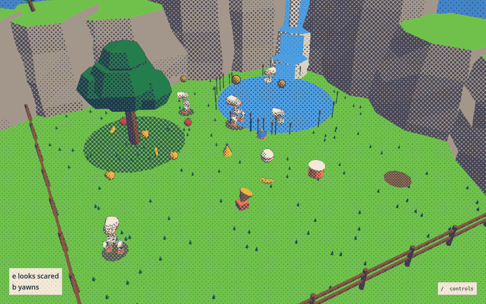
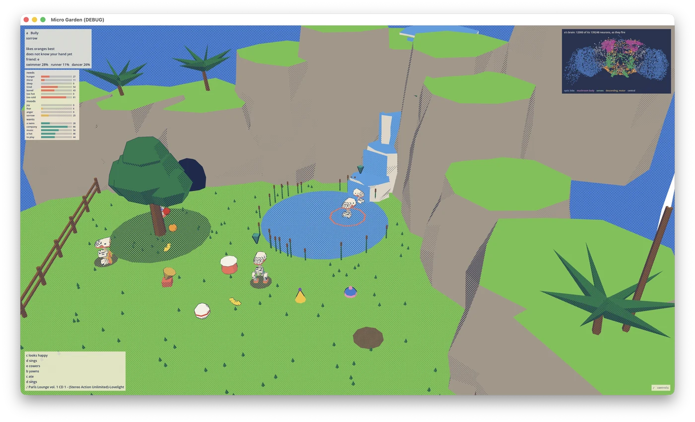

# Micro Garden



Micro Garden is a simulation of five microducks, each running on its own copy of a whole fruit fly brain. I built it to ask whether a wiring diagram, a body with needs, a personality and a place to live are enough to get emergent behaviour. The brain is the FlyWire connectome, about 139,000 neurons and 2.7 million connections, simulated as spiking neurons. Each duck can smell, see and hear, and it gets hungry, thirsty, hot and sleepy. It learns, makes friends and holds grudges.

The ducks are modelled on the [microduck](https://github.com/pollen-robotics/microduck), an open-source robot, and the brain talks to the body through the robot's command protocol. The body can be a simple 2D simulation in Python or the microduck's MuJoCo simulation. Either way, a low-poly 3D garden in Godot shows what the ducks are doing. Everything runs in simulation, and I have no plans to build the physical robots.

## Run it

You need Python 3.12, [uv](https://docs.astral.sh/uv/), [Godot 4](https://godotengine.org), and a machine PyTorch supports. I use an M4 Pro. The garden looks for Godot at the path in `GODOT`, then on your path, then in `/Applications`. The repo does not redistribute the FlyWire data, so download two files into `data/`:

- `proofread_connections_783.feather` from the [FlyWire v783 release on Zenodo](https://doi.org/10.5281/zenodo.10676866)
- `Supplemental_file1_neuron_annotations.tsv` from [flyconnectome/flywire_annotations](https://github.com/flyconnectome/flywire_annotations)

Then open the garden:

```
uv run python -m garden
```

Closing the window saves the garden. When you come back, the ducks are older by however long you were away. Each new duck gets a random name and personality. Add `--fresh` to start with new ducks, `--labels Bully,Napper,Carefree,Chatty,Scaredy` to choose the personalities, and `--blind` to hide which duck has which until you quit. Five ducks run at about 0.6 times real time on an M4 Pro, and anything else on the GPU slows them more.

## The garden

The garden is modelled on the Chao gardens of Sonic Adventure 2: a lawn inside rock walls, a pond under a waterfall, a fruit tree, and a cliff above the sea. The wind turns slowly over the day, and flags and reeds show which way it blows. That matters because the wind carries the smell of food, and a hungry duck follows that smell upwind.



Click a duck to follow it and see its needs, moods and 12,000 of its neurons firing at their real positions. Press `/` to see every control. The main ones are:

- `Tab` rides the selected duck with W, A, S and D, and shows what its eyes see.
- `H` gives you a hand to pick up and throw fruit, hats, balls, instruments or ducks.
- `F` shakes the tree, `G` gives the selected duck a fruit, `P` pets it, and `C` claps.
- `T` drops a hat, `B` a ball, `D` a drum, `M` the music box, and `I` another instrument.

In the Godot garden, the music box plays mp3s you put in `~/.cache/micro-garden/music/`. No music ships with the project. The browser garden's music box plays a built-in tune instead.

## What the ducks do

A duck eats when it is hungry, drinks when it is thirsty, sleeps when it is tired, and cools off in the pond or the shade when it is hot. It makes friends with ducks it spends time with and holds grudges against ducks that shove it. It learns to trust you if you pet and feed it. It plays with balls and instruments, dances to music, and tries on hats.

Ducks get better at swimming, walking, eating, fighting, dancing, fashion and music by doing them, and a clumsy duck trips, misses or hits a sour note now and then. Other ducks may laugh, comfort, or pile on, and one reaction can set off another. Personality makes each of these likelier or rarer but never rules it out.

## What the brain does and what is hand-written

Senses enter the brain through the fly's sensory neurons. Vision goes through a model of the optic lobe, the fly's visual system ([flyvis](https://github.com/TuragaLab/flyvis)). Movement comes out through descending neurons, which carry the brain's commands down to the body. I found the useful ones by screening the whole brain. The clearest is a neuron called DNge091, which fires on the side the wind comes from. A duck that smells food walks up the odour plume the way a real fly does. With the real wiring a duck finds a dish in 20 of 20 trials, and with the wiring shuffled it finds it in 1 of 20.

All learning happens in the mushroom body, the fly's learning centre. It changes the connections from Kenyon cells to the mushroom body's output neurons, and dopamine neurons for reward and punishment decide when those connections change.

Some behaviour is hand-written code rather than the brain's output, and the code marks each of these places "Explicit". The body code decides how much weight each sense gets. The garden has two smells, food and the stink of trash. The brain's left-right signal for food is weaker than its steering noise, which is why a duck finds food by walking upwind. A neuron called DNp32 does fire more on the stink's side, and hand-written code uses the duck's personality to decide whether it runs from the stink or lingers.

Hand-written code also turns a duck toward music, balls, other ducks, you, and the pond or shade. Social behaviour, trust and skills are all hand-written too. Personalities are preset combinations of continuous traits, and each new garden picks five of the 19.

## Other ways to run it

The 2D window is a simpler view:

```
uv run python -m body.stub2d.stub --view --brain
```

To run the ducks as simulated robots, check out [microduck](https://github.com/pollen-robotics/microduck) and [microduck_rl](https://github.com/pollen-robotics/microduck_rl), start five with `DUCK_SIM_DUCKS=5 scripts/duck-sim`, then run:

```
uv run python -m body.mujoco.adapter --ducks 5 --brain --godot
```

The microduck_rl walking policy does not yet track a commanded velocity ([microduck_rl issue 46](https://github.com/pollen-robotics/microduck_rl/issues/46)), so these ducks walk at one pace and turn on the spot.

The whole garden also runs in a web browser, with nothing to install. Each duck's brain runs in a separate background thread, and three.js draws the garden in the same style as the Godot one. The browser version is a port of the Python code: the brain, the body, the world and the senses are rewritten in JavaScript, with one JavaScript module for each Python one. Pack the garden once, then serve the `web` folder:

```
uv run python -m web.pack
python3 -m http.server -d web 8000
```

Open `http://127.0.0.1:8000` for the garden. The packed files come to about 9 MB, and `web/data` is everything a website needs besides the code. The browser saves the garden in its local storage. Every duck in the browser can see. On an M4 Pro, one duck takes about 5 ms of each 20 ms step with its eyes, and 1.3 ms without them.

If you connect a Spotify Premium account, the music box plays my playlist through Spotify instead of its built-in tune. While the garden's Spotify app is in development mode, only accounts I have added to it can connect.

The check page at `http://127.0.0.1:8000/check.html` tests the browser version against the Python. It puts the same inputs through both and compares the results:

- The brain matches spike for spike, learning included.
- The eyes match to within two millionths, because they add their inputs up in another order.
- The body, the world, the senses, the save file and the decoder, which turns spikes into movement, match to within rounding error.

After the comparison, the page times five ducks running at once.

I keep the JavaScript in step with the Python by hand. After a change to the Python, run `web.pack` again and open the check page. A check fails when the JavaScript has fallen behind, but only in the parts the checks cover. Anything left to chance can only be compared by how often it happens, not step by step.

## Where things are

- `garden.py` opens the garden.
- `brain/` holds the connectome loader, the spiking model, senses, motor output, learning, needs, social life and personalities.
- `body/` holds the robot command contract, the 2D body and the MuJoCo adapter.
- `world/` holds the garden itself: wind, smells, water, weather, fruit and toys.
- `viewer/` holds the debug window and the Godot garden.
- `web/` holds the browser garden: `brain.js` and `lif.js` for the brain, `garden/` for the body, world and senses, `view/` for the drawing, and `check.js` for the comparison with the Python.

## Credit

The connectome is the work of the FlyWire Consortium. The repo does not redistribute its data: you download it into `data/`, which git ignores. The connectivity ([Zenodo 10.5281/zenodo.10676866](https://doi.org/10.5281/zenodo.10676866)) is CC BY 4.0. The annotations come from [flyconnectome/flywire_annotations](https://github.com/flyconnectome/flywire_annotations), which has no licence file and asks users to cite its papers. Please cite:

- Dorkenwald et al. (2024), "Neuronal wiring diagram of an adult brain", *Nature*.
- Schlegel et al. (2024), "Whole-brain annotation and multi-connectome cell typing of *Drosophila*", *Nature*.
- Matsliah et al. (2024), "Neuronal parts list and wiring diagram for a visual system", *Nature*.
- Berg et al. (2025), male CNS connectome and annotation updates.

This project also builds on:

- [pollen-robotics/microduck](https://github.com/pollen-robotics/microduck) (Apache-2.0). The body contract follows robotd's JSON-RPC names, and no code is copied.
- [pollen-robotics/microduck_rl](https://github.com/pollen-robotics/microduck_rl) (Apache-2.0). `viewer/godot/robot.json` is derived from the microduck's meshes and `viewer/godot/clips.json` records its policies' motions. Its licence is in `viewer/godot/LICENSE-microduck`.
- [TuragaLab/flyvis](https://github.com/TuragaLab/flyvis) (MIT) is the visual front end.
- [snedea/flybrain](https://github.com/snedea/flybrain) (MIT) supplied starting LIF parameters and the neuron group map as a reference, and no code is copied.
- [philshiu/Drosophila_brain_model](https://github.com/philshiu/Drosophila_brain_model) (MIT, Shiu et al. 2024) gave the idea of treating glutamate as inhibitory and reading sugar responses from proboscis motor neurons, and no code is copied.

The model also draws on Gaudry et al. (2013), Schretter et al. (2020), Deutsch et al. (2020), and Bailey and Katchabaw's stimulus-and-response framework. Where the model departs from them, the code says so.

The code is MIT licensed, and the FlyWire data keeps its own terms.
